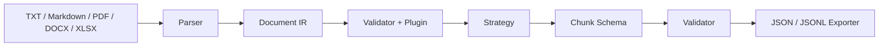

# Universal RAG Chunker

[English](README.en.md) · [项目介绍页](https://Chainsy3.github.io/universal-rag-chunker/) · [格式支持](docs/formats.md) · [架构](docs/architecture.md) · [问题反馈](https://github.com/Chainsy3/universal-rag-chunker/issues)


将 TXT、Markdown、PDF、Word（DOCX）、Excel（XLSX）转为可复现、可溯源的检索文本块。核心不依赖行业词表、模型服务或向量数据库。

**状态：0.2.0 候选版本，尚未发布。** 支持 Python 3.11+。当前实现保守保留 Markdown 标记；不宣称是完整 CommonMark 解析器，也不宣称已验证检索效果提升。

## 安装和运行

在本目录使用 Python 3.11 或以上版本：

```sh
git clone https://github.com/Chainsy3/universal-rag-chunker.git
cd universal-rag-chunker
python -m venv .venv
# Windows: .venv\Scripts\activate
# Linux/macOS: source .venv/bin/activate
python -m pip install ".[all]"
urc chunk examples/guide.md --config configs/default.toml --output out
urc validate out/document.ir.json --chunks out/chunks.jsonl
urc inspect out/document.ir.json
urc list-components
```

处理其他格式的命令相同，自动按后缀选择解析器：

```sh
urc chunk document.pdf --output out/pdf
urc chunk document.docx --output out/word
urc chunk workbook.xlsx --output out/excel
```

只需要基础文本功能时安装 `.` 即可；也可以分别安装 `.[pdf]`、`.[word]`、`.[excel]`。缺少依赖时会提示对应安装命令。

输出包含 `document.ir.json`、`chunks.jsonl`、`report.json`、`manifest.json`。默认不覆盖现有输出；明确需要替换时增加 `--overwrite`。导出采用临时目录及备份恢复机制；不保证断电或并发写同一目录时的事务性。

## Python API

```python
from universal_rag_chunker import Config, Pipeline
from universal_rag_chunker.exporters import export

result = Pipeline().run("examples/guide.md", Config(), source_id="examples/guide.md")
print(result.report)
export(result, "out")
```

`Pipeline.run()` 不写文件。默认 source_id 为文件名；处理不同目录的同名文件时，应显式传入相对项目根路径或业务文档 ID。原始文件 hash 参与 document_id。时间与随机 run_id 只出现在 manifest，不参与确定性文档/切块 ID。

## 当前能力



- 两层格式：Document IR、Chunk Schema，新输出使用 1.1，仍可读取/校验旧 1.0。
- UTF-8 TXT、Markdown ATX 标题、段落、列表项和围栏代码；保留 CRLF 与 Unicode 来源偏移。
- `fixed` 字符窗口；`recursive` 在结构内优先换行和句界，并合并同标题下的短文本。
- 字符硬上限、重叠、确定性 ID、原文重建与非空白字符覆盖检查。
- 显式 Parser/Strategy/Plugin 注册，默认无插件；示范插件只添加元数据。
- TOML 配置、CLI、JSON/JSONL 导出、JSON Schema、测试及 CI 配置。
- PDF 提取文本层，保留 1 起页码；无文本页记录诊断，整个文件无文本时提示需要 OCR。
- DOCX 按正文顺序提取段落、标题与表格行，包含嵌套表格文本，保留正文元素索引/表格行号。
- XLSX 保留所有工作表（含隐藏表）、非空单元格、公式文本、日期、零值与布尔值；记录工作表/行/列及单元格坐标。
- Chunk 的 `metadata["core.source_locations"]` 直接给出页码、正文位置或工作表位置，也可通过 IR source_spans 查询来源。

字符数为 Unicode code point 数，不是 token 数。默认只在单个 block 的切分窗口之间重叠；不跨章节补 overlap。短块合并是目标，不保证每块达到 minimum_characters。

## 边界

当前不支持扫描 PDF 的 OCR、旧二进制 `.doc`/`.xls`、任意 JSON 文件语义解析、嵌套列表树、Setext 标题、HTML 表格结构、embedding 或 GUI。Markdown 图片/公式引用保留为文本；代码围栏和标题标记也保留。只忽略全空白切块。

TXT/Markdown IR 无损分割原始字符串；二进制格式 IR 保存解析器提取/规范化后的文本及来源定位，不能从提取文本恢复原文件。二进制覆盖率衡量 **已提取文本** 的非空白字符，不代表图片、复杂版式、页眉页脚等原文件内容被全部识别。PDF 不恢复表格结构；Word 不提取图片、文本框、页眉页脚及修订内容；Excel 不计算公式、不猜测表头。合并单元格只保留锚点值，长表格行可拆成多个带同一来源行号的块。

插件的 prepare 阶段只允许修改文档 metadata。Chunk 文本必须能由 source_spans 直接拼接重建，不支持无来源的标题前缀或删除内容。未知 schema 版本拒绝。完整限制与设计差异见 [实现说明](docs/implementation.md)。

## 配置与错误

配置优先级为默认值 < TOML < 显式 CLI 参数。拼错的键或组件名报错。可通过 `--strategy fixed`、`--max-characters`、`--minimum-characters`、`--overlap-characters`、`--format json` 覆盖配置。

退出码：0 成功；2 参数/配置；3 读取/解析；4 验证；5 导出。日志不输出正文，但 I/O 错误可能包含路径；导出 manifest 默认只记录文件名和 source_id。

## 开发验证

```sh
python -m pip install ".[all]"
python -m unittest discover -s tests -v
python -m compileall -q src
python -m pip install build
python -m build
```

JSON Schema 随 Python 包发布，位于 `src/universal_rag_chunker/schemas/`。配置文件 schema_version 仍为 1.0（配置契约未变），区别于 IR/Chunk 的 1.1。内部校验器只实现这些 Schema 使用的关键字，不是面向任意 JSON Schema 的通用验证库。Schema 可通过 `python tools/generate_schemas.py` 重新生成。Office 测试需要对应 extras；CI 安装全部格式依赖，避免跳过格式测试。

## 文档与贡献

- [数据契约与来源定位](docs/data-model.md)
- [插件开发](docs/plugins.md)
- [迁移说明](docs/migration.md)
- [已知限制](docs/implementation.md)
- [本地验证记录](docs/verification.md)：Windows/Python 3.12 上 33 项测试通过；跨平台 CI 状态以 GitHub Actions 实际结果为准。
- [贡献指南](CONTRIBUTING.md) · [变更记录](CHANGELOG.md)

## 许可证

采用 [MIT 许可证](LICENSE)，Copyright © 2026 Chainsy3。项目示例为自编内容；不包含原业务资料、缓存或本机启动器。格式依赖各自使用其原有许可证。
